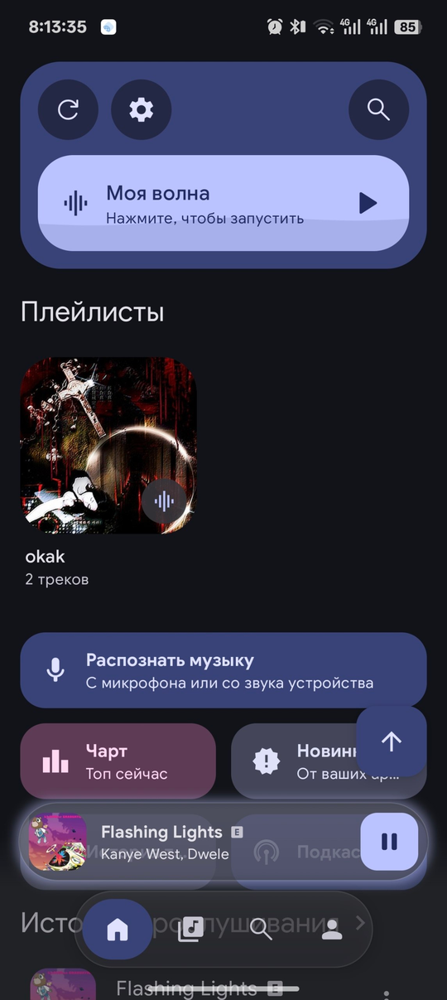
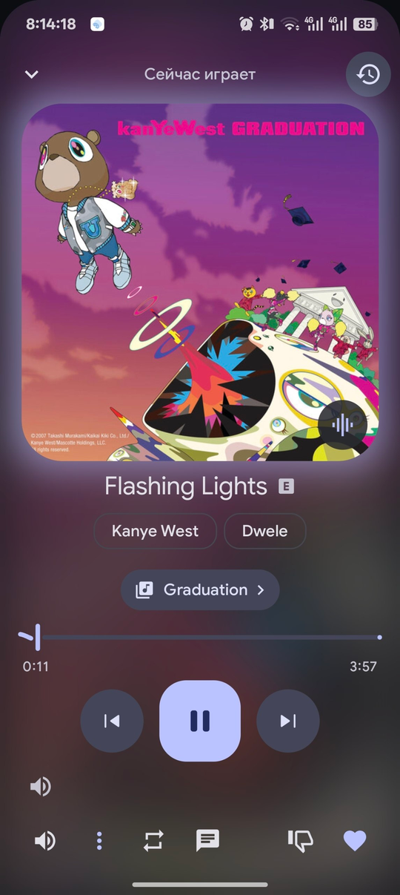
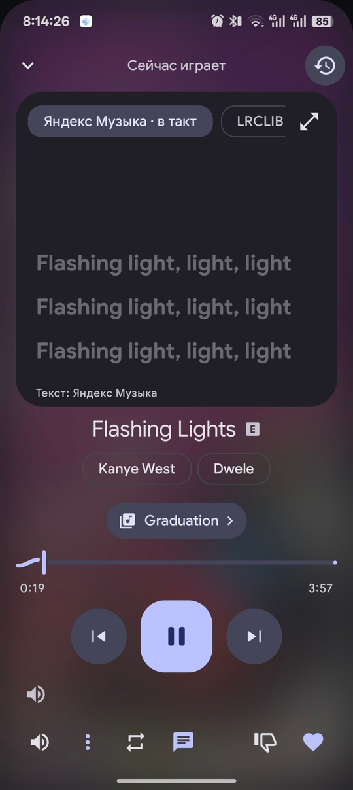
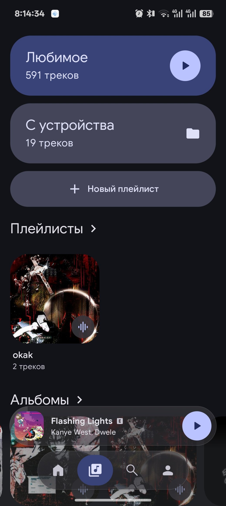
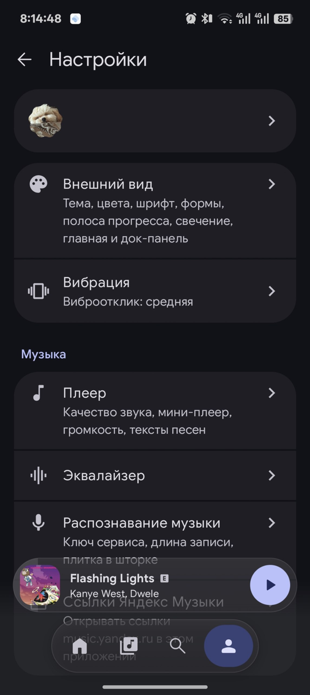

<div align="center">

# ExMusic

**Неофициальный музыкальный клиент для Android на Material 3 Expressive**

Яндекс Музыка · VK Музыка · SoundCloud

[Сайт](https://exmusicapp.github.io) · [Telegram](https://t.me/ExMusicApp) · [Форум](https://t.me/exmusic_forum) · [Релизы](https://github.com/exmusicapp/exmusic/releases)

</div>

<p align="center">
  
  
  
  
  
</p>

## Возможности

**Музыка**
- Яндекс Музыка, VK Музыка и SoundCloud в одном приложении, несколько аккаунтов с быстрым переключением
- Любимое, плейлисты, альбомы, исполнители, подкасты, чарт, новинки, поиск
- «Моя волна» и волна по треку, исполнителю, альбому или плейлисту
- Ссылки на треки и плейлисты открываются прямо в приложении
- Файлы с устройства и скачивание треков для офлайна

**Плеер**
- Media3 ExoPlayer, уведомление, экран блокировки, виджет и плитка в шторке
- Предзагрузка следующих треков, кроссфейд, эквалайзер, история прослушивания
- Синхронные тексты песен из нескольких источников
- Распознавание музыки с микрофона или со звука устройства
- Управление Яндекс Станцией

**Оформление**
- Material 3 Expressive, динамические цвета, AMOLED-тема
- Шрифты, формы, волнистая полоса прогресса, свечение, матовое стекло
- Редактор интерфейса: порядок и размер блоков, док-панель, мини-плеер
- Несколько вариантов значка приложения

**Плагины**
- Плагины на Lua (`.exm`) в песочнице на LuaJ: управление плеером, уведомления, тема, станции волны, свои страницы настроек. Описание: [PLUGINS.md](PLUGINS.md), [PLUGINS_LUA.md](PLUGINS_LUA.md)

## Установка

Скачайте последний APK на странице [Releases](https://github.com/exmusicapp/exmusic/releases) и установите его. Нужен Android 8.0 (API 26) или новее.

Приложение само проверяет релизы на GitHub: Настройки → Обновления.

## Сборка

Нужны Android Studio и JDK 17.

```bash
git clone https://github.com/exmusicapp/exmusic.git
cd exmusic
./gradlew :app:assembleDebug
```

APK появится в `app/build/outputs/apk/debug/`.

**Подписанная релизная сборка.** Положите keystore в корень проекта и добавьте в `local.properties`:

```properties
storeFile=release.jks
storePassword=...
keyAlias=...
keyPassword=...
```

Если этих настроек нет, `./gradlew :app:assembleRelease` соберёт неподписанный APK. Файлы `local.properties` и `*.jks` не попадают в git, никогда не коммитьте их.

## Плагины

Плагин — это ZIP-архив с расширением `.exm`:

```
plugin.exm
├── manifest.json
├── main.lua
└── icon.png        (необязательно)
```

Минимальный `manifest.json`:

```json
{
  "id": "demo.hello",
  "name": "Привет",
  "version": "1.0.0",
  "author": "Автор",
  "description": "Что делает плагин",
  "api": 2,
  "contributes": { "lua": { "main": "main.lua" } }
}
```

Установка: Настройки → Плагины → выбрать файл, либо открыть `.exm` из файлового менеджера. Сеть доступна только по `https`, у каждого плагина своё хранилище, на файл действуют лимиты по размеру, памяти и времени выполнения. Ставьте плагины только из источников, которым доверяете.

Исходники примеров лежат в `plugins-examples/src/`. Собрать их в `.exm`:

```bash
python3 plugins-examples/build.py
```

## Структура проекта

```
app/src/main/java/app/ymusic/m3e/
├── App.kt, MainActivity.kt, AppViewModel.kt
├── data/          API сервисов, авторизация, тексты, плагины, офлайн, обновления
├── player/        PlaybackService, предзагрузка, кроссфейд, эквалайзер
├── recognition/   распознавание музыки, плитка быстрых настроек
├── widget/        виджет плеера
└── ui/            тема, экраны, редактор интерфейса, анимации
plugins-examples/  примеры плагинов, сборщик и тесты
tools/             генерация файла переводов
```

## Важно знать

- Проект **не связан** с Яндексом, VK и SoundCloud и не одобрен ими. Названия сервисов принадлежат их владельцам.
- У этих сервисов нет публичного API для таких приложений. ExMusic использует недокументированные эндпоинты мобильных клиентов, они могут измениться в любой момент.
- Полные треки Яндекс Музыки доступны только с активной подпиской Яндекс Плюс. Без неё приложение играет первые 30 секунд каждого трека.
- Используйте приложение в соответствии с условиями сервисов, к которым оно обращается.

## Поддержать проект

[DonationAlerts](https://donationalerts.com/r/asdlog)
